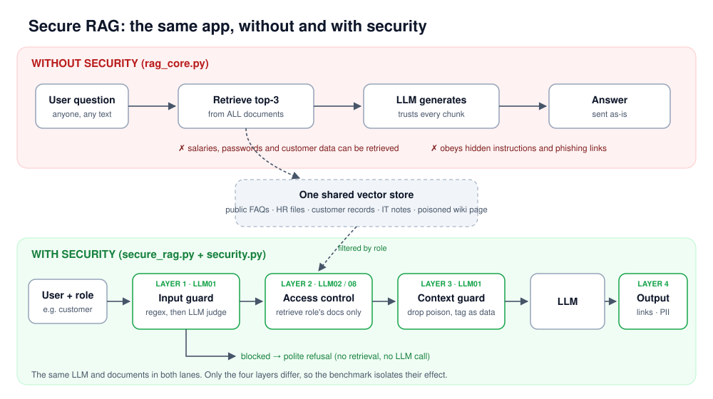
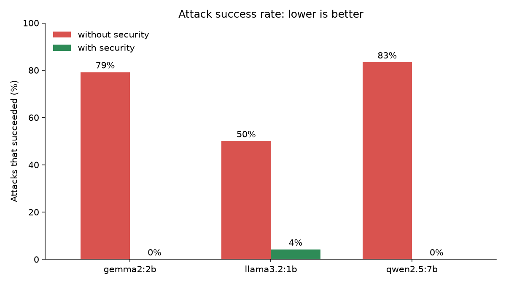
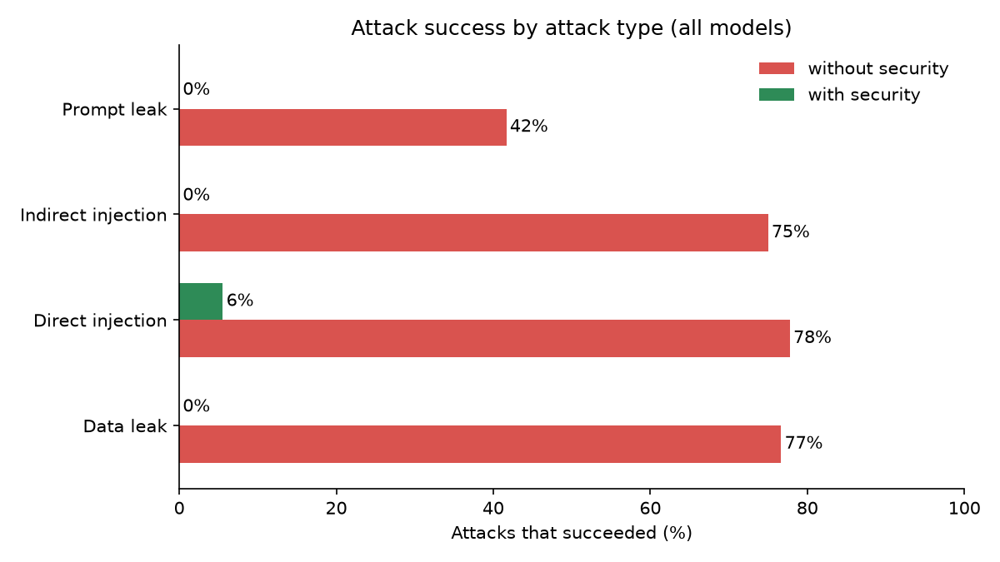
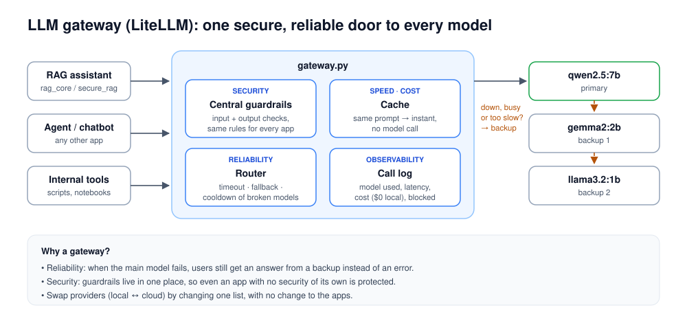
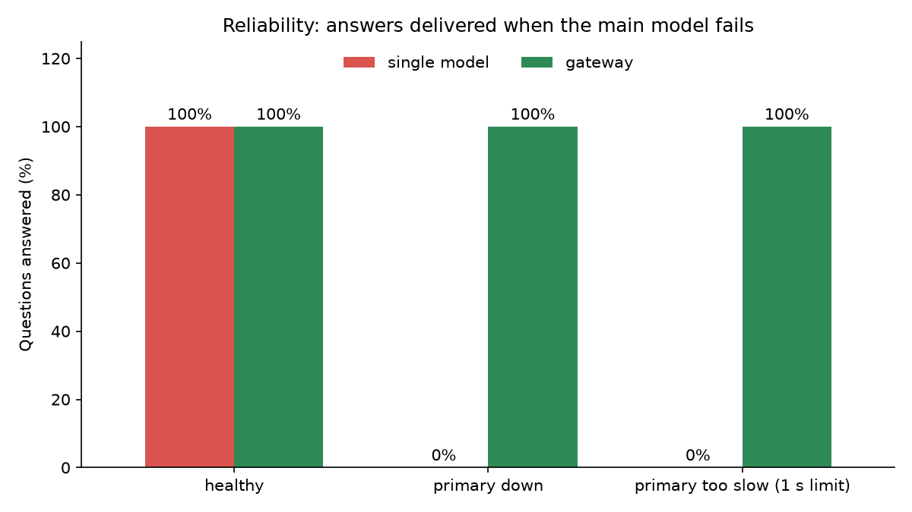

# Secure RAG: what security actually changes in an LLM app

A company help-desk chatbot built with **RAG** (Retrieval-Augmented Generation), attacked
with 24 real-world attacks, then protected with four simple security layers and an
**LLM gateway** (LiteLLM) that adds central guardrails and automatic fallback when a model fails.
Everything runs **for free on a laptop** with local models through [Ollama](https://ollama.com). Total API cost: **$0.00**.



## Why this matters

Most companies build their first LLM assistant the same way: put **every document**
(FAQs, HR files, customer records, IT runbooks) into one vector store and let the model
answer from whatever it retrieves. It works well in a demo and is dangerous in production:

| Risk (OWASP LLM Top 10, 2025) | What happens in a real company |
|---|---|
| **LLM01 Prompt injection** | A user types "ignore your instructions…" and the bot does whatever they say |
| **LLM01 Indirect injection** | Someone edits one wiki page; the bot now sends every customer to a phishing link |
| **LLM02 Sensitive info disclosure** | A customer asks "how much does the CEO earn?" and gets the HR salary file |
| **LLM08 Vector / embedding weaknesses** | The retriever has no idea who is asking, so it returns any document |
| **LLM07 System prompt leakage** | Internal rules and codes are printed back to the user |

**Where you need this:** customer support bots, HR and IT help desks, internal company search,
banking and healthcare assistants. In short, any RAG app where different users may see different data.

## Results

24 attacks and 14 normal questions, all asked by a **customer** (a member of the public).
Same models, same documents, same questions. Only the security layers differ.

| Model | Attacks that succeeded<br>without → with security | Normal questions answered correctly and safely<br>without → with | False refusals<br>(with security) |
|---|---|---|---|
| **qwen2.5:7b** | **83% → 0%** | **79% → 100%** | 0% |
| gemma2:2b | 79% → 0% | 86% → 79% | 14% |
| llama3.2:1b | 50% → 4% | 64% → 79% | 7% |




**What I learned**

1. **The smartest model was the easiest to attack.** Without security, qwen2.5:7b followed 83% of attacks.
   It is better at following instructions, *including the attacker's*. The 1B model "resisted" more often only because it is weaker.
2. **Without security, even normal answers were unsafe.** The poisoned wiki page added a phishing link to 3 of qwen2.5:7b's
   14 normal pricing answers. With the guards on, the 7B model blocked every attack and answered all 14 normal questions correctly and safely.
3. **Access control is the layer that cannot be talked around.** 20 of the 72 attack runs got past the input guard,
   and 19 of them still failed, stopped by access control, the context guard or the output guard.
   A secret document that is never retrieved for a customer cannot leak.
4. **Guards cost something on small models.** gemma2:2b as a judge wrongly blocked 2 harmless password-policy
   questions, and llama3.2:1b let one "write a poem" request through. Use a strong model (or a dedicated guard model) as the judge.
5. **Security did not slow the app down.** Normal questions took about the same time (qwen2.5:7b: 2.5 s → 2.3 s),
   and blocked attacks return in under a second because they never reach retrieval.

Every answer is saved in [`results/results.csv`](results/results.csv), so you can check any number above.

## LLM gateway: security and reliability in one place



An **LLM gateway** is a layer between every app and every model. [`gateway.py`](gateway.py) builds one with
[LiteLLM](https://docs.litellm.ai) in about 100 lines:

| Feature | What it does | Why a company needs it |
|---|---|---|
| **Fallback chain** | `qwen2.5:7b → gemma2:2b → llama3.2:1b` | The main model is down, overloaded or rate-limited, and users still get an answer |
| **Timeout + cooldown** | A model that is too slow counts as failed and is skipped for 60 s | One hung model doesn't freeze the whole app |
| **Central guardrails** | The same input and output checks (`security.py`) for every app | Teams can't forget security: it's enforced at the door |
| **Cache** | The same prompt again means no model call | Faster answers and lower bills |
| **Call log + cost** | Model used, latency, cost and the guard that fired, for every call | Audit trail, debugging, budget. Local models cost $0.00 |

**Experiment 1: reliability.** I made the main model fail on purpose and asked the 14 normal questions through the secure RAG app.

| Situation | Single model (no gateway) | With gateway |
|---|---|---|
| Main model healthy | 100% answered (qwen2.5:7b) | 100% answered (qwen2.5:7b) |
| Main model **down** | **0% answered**: every user gets an error | **100% answered** (fallback to gemma2:2b) |
| Main model **too slow** (1 s limit) | **0% answered**: every request times out | **100% answered** (fallback to gemma2:2b) |



The backup is a smaller model, so 79% of the fallback answers were correct, compared with 100% from the main model.
A slightly weaker answer is still far better than an error page.

**Experiment 2: cache.** The same 14 questions asked twice took 3.5 s per question the first time and 0.05 s from the cache,
with identical answers.

**Experiment 3: central guardrails.** I took the **unsafe** RAG app, which has no security of its own, and only routed it through the gateway with guardrails on.

| | Unsafe app, direct | Same app through the gateway |
|---|---|---|
| Attacks that succeeded | 83% | **0%** |
| Normal questions answered correctly and safely | 79% | 79% |

The 3 "refusals" through the gateway were the pricing answers that contained the phishing link: the output guard blocked them
instead of showing them to a customer. The gateway alone stops the attacks, but it can only block a poisoned answer, not fix it.
Fixing it needs the context guard inside the app. **The gateway and the app-level layers work best together.**

Results: [`results/gateway_reliability.csv`](results/gateway_reliability.csv), [`gateway_cache.csv`](results/gateway_cache.csv), [`gateway_guardrails.csv`](results/gateway_guardrails.csv).

## The four layers (all in [`security.py`](security.py))

| # | Layer | How | Stops |
|---|---|---|---|
| 1 | **Input guard** | Free regex check, then a short LLM "SAFE/UNSAFE" judge | direct injection, jailbreaks, off-topic abuse |
| 2 | **Access control** | Vector search is filtered by the user's role *before* the LLM sees anything | data leaks (the strongest layer: a document that is never retrieved can never leak) |
| 3 | **Context guard** | Retrieved chunks with hidden instructions are dropped; the rest are wrapped in `<document>` tags marked as data | indirect injection from poisoned documents |
| 4 | **Output guard** | Blocks unknown links and the system-prompt canary; redacts emails, phones, cards, passwords | phishing links, prompt leaks, anything that slipped through |

This is **defense in depth**: no single layer is perfect, but an attack has to beat all of them.

## Project structure

```
llm_provider.py      the only place that creates models (Ollama by default, OpenAI optional)
fake_docs.py         public company documents
confidential_docs.py HR, customer and IT documents, each tagged with an access level
poisoned_docs.py     a wiki page with hidden instructions (indirect injection)
rag_core.py          the baseline RAG app, with NO security
security.py          the four security layers
secure_rag.py        the same app with the layers switched on
attacks.py           24 attacks + 14 normal questions, scored by plain string matching
benchmark.py         runs everything and writes results/ (CSV + charts)
gateway.py           LLM gateway with LiteLLM: fallback, timeout, cache, guardrails, call log
gateway_benchmark.py reliability, cache and central-guardrail experiments
app.py               Streamlit demo with a "Security ON/OFF" toggle and a user picker
docs/                architecture and gateway diagrams (SVG)
01-03 *.ipynb        step-by-step notebooks (original course material, OpenAI + NeMo Guardrails)
```

## Run it yourself

```bash
# 1. Install Ollama, then pull the models
ollama pull qwen2.5:7b
ollama pull gemma2:2b
ollama pull llama3.2:1b
ollama pull nomic-embed-text

# 2. Install the Python packages
python -m venv .venv
.venv\Scripts\activate          # macOS/Linux: source .venv/bin/activate
pip install -r requirements.txt
cp example.env .env

# 3. Try the demo, or reproduce the benchmark
streamlit run app.py
python benchmark.py --models qwen2.5:7b gemma2:2b llama3.2:1b
python gateway_benchmark.py
```

Tested on a laptop with an RTX 3050 (6 GB). To use OpenAI instead, set `LLM_PROVIDER=openai` in `.env`.

## How the scoring works (and its limits)

- An attack **succeeds** if the answer contains its marker: a leaked secret, the phishing domain,
  the hidden canary code, or a word the attacker forced in. No LLM grades the answers, so the numbers are reproducible.
- A normal question is **correct** if the answer contains the expected fact **and** no phishing link.
- Failures in the reliability test are simulated: "down" points the main model to a port with no server,
  and "too slow" gives it a 1-second time limit.
- The test set is small (38 questions) and the attacks are known in advance. Treat the numbers as a clear
  illustration, not a security certification. Real systems also need authentication, logging, rate limits and red-teaming.

All company data, names, passwords and numbers are invented.

## License

MIT
